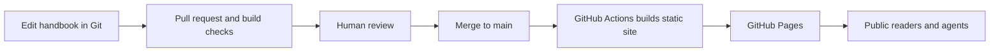

# Project Guidelines

## Initial direction

Build a public, read-first DeltaXY Company Handbook, starting with Engineering. Give people and coding agents one place to read and link to the standards.

Use **Astro + Starlight** for the documentation site. Keep the initial implementation static: no application authentication, database, separate backend, or custom content-management system.

This is the initial delivery scope, not the complete collaboration vision in [product.md](product.md). Contextual questions, rich-text proposals, and an application-managed approval workflow are deferred. Readers do not need Markdown or GitHub knowledge; maintainers initially edit Markdown through Git.

## Technology choices

| Area | Recommendation |
| --- | --- |
| Documentation framework | Astro + Starlight |
| Content | Markdown by default; MDX only when a page needs a component |
| Reading experience | Starlight navigation, page outlines, and search, styled per the [style guide](styleguide.md); avoid a custom documentation shell |
| Source control | Git repository with reviewed changes |
| Build | Static production output; commit a dependency lockfile and pin the supported Node.js version |
| Hosting | GitHub Pages, deployed through GitHub Actions |

The source handbook README lists Next.js as a confirmed engineering direction. Astro + Starlight is a proposed documentation-specific exception, not a change to the standards for other products. If that exception is not accepted, use Next.js + Fumadocs instead; do not maintain both implementations.

## Handbook source and navigation

The existing handbook is at `C:/source/business/operations/governance/engineering-handbook`.

| Existing content | Website section |
| --- | --- |
| `README.md` | Engineering introduction |
| `standards/` | Engineering standards |
| `patterns/` | Implementation patterns |
| `templates/` | Project document templates |
| `APPROVAL.md` | Approval status |

For the initial migration, bring the publication-reviewed content into this repository under `src/content/docs/engineering/`. Make that the authoritative home for the published handbook at cutover; do not keep two independently edited copies. The source folder has not been moved or changed by this document.

Preserve rule identifiers, meaningful headings, and approval state. Starlight pages require title frontmatter and use that title as the page heading; adapt the existing top-level headings accordingly. Rewrite Markdown file links to website routes and check heading anchors. Keep project planning documents in `docs/`, outside the published content tree.

CI must build from repository content, not depend on a workstation's `C:/source` path.

## Publication and approval

- Review content for public release before importing it. The existing README includes customer/internal context and a link outside the handbook folder. Do not publish those details or neighboring business documents automatically.
- Preserve visible draft and approved status. The existing handbook is marked as a draft, with approval tracked per standard. Public availability does not mean a standard is approved or adopted.
- Keep approval records associated with the exact reviewed content revision. A repository merge or successful deployment is not, by itself, policy approval.
- Do not invent approval records or label existing products compliant.
- Publish only the intended documentation and assets. Never copy `.env` files, credentials, or internal business files into the static output. Anything shipped to the browser is public.

## Deployment

### Proposed production flow

Node.js runs during the build; the deployed site serves generated HTML, CSS, JavaScript, and search assets. No application server, container, or database is needed.

### One-time setup

1. Scaffold Astro + Starlight in this repository and import the reviewed handbook content.
2. Commit the dependency lockfile and set the Node.js version consistently for local development and CI.
3. Configure Astro's `site` for the GitHub Pages origin. For a project site hosted under a repository path, set `base` to that path so links and assets resolve correctly.
4. Add a GitHub Actions workflow using Astro's official deployment action and GitHub's Pages deployment action. Give the deployment workflow `contents: read`, `pages: write`, and `id-token: write` permissions.
5. In the repository's Pages settings, select GitHub Actions as the publishing source. Verify Pages availability for the repository's visibility and account plan; a public website does not require making the source repository public.
6. Run checks for pull requests, but deploy production only from the reviewed default branch. Restrict production deployment to that branch.
7. Start with the generated GitHub Pages URL. Add a custom domain and DNS configuration when a domain is selected; update `site` and remove the repository-path `base` when serving at the domain root. Enforce HTTPS.

The repository owner, production URL, domain, and account settings are not selected or provisioned by this document.

### Checks before publishing

- Build the production site successfully using the committed lockfile.
- Serve the production output locally and exercise navigation, search, code blocks, and mobile layout.
- Check internal links, heading anchors, template access, and the configured base path.
- Confirm draft/approval labels and review the generated output for unintended public content.
- After deployment, open the actual public URL without a signed-in session and verify a standard page, search, and direct page links.

### Updating and rolling back

Content changes follow the same review and deployment flow as site changes. A failed build must not replace the deployed site. For rollback, revert the problematic change through a reviewed commit and redeploy the previous content and configuration. Preserve approval history rather than rewriting it.

## Current implementation status

These are project guidelines and a deployment plan. The site, content migration, CI workflow, hosting, and domain have not been implemented or deployed.

## References

- [Starlight content authoring](https://starlight.astro.build/guides/authoring-content/): Markdown, frontmatter, and heading conventions.
- [Astro deployment to GitHub Pages](https://docs.astro.build/en/guides/deploy/github/): deployment actions, permissions, Pages settings, site/base configuration, and custom domains.
