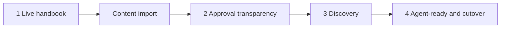

# Delivery Roadmap

## Scope and status

Deliver the public, read-first handbook described in [product.md](product.md), built with the stack and publishing rules in [project-guidelines.md](project-guidelines.md) and the design in [styleguide.md](styleguide.md).

| Stage | Status |
| --- | --- |
| Phase 1: live handbook | Done. See the [release record](releases/phase-1.md) |
| Content import: whole handbook | Done. See the [release record](releases/content-import.md) |
| Phase 2: approval transparency and citable rules | Planned |
| Phase 3: discovery and content types | Planned |
| Phase 4: agent-ready handbook and source cutover | Planned |

Production URL: https://deltaxy-ai.github.io/deltaxy-handbook/. The site is excluded from search engines (`noindex`), but anyone with the link can read it, and the repository is public.

All source content is published: README, approval register, 14 standards, 3 patterns, and 5 templates. Every page is a Draft, and no standard is approved. The remaining phases add site features. They no longer publish content in batches.

Out of scope: application authentication, a database or separate backend, contextual questions, rich-text proposals, and an application-managed approval workflow.

## How phases are structured

Each phase is a vertical slice: a site capability, exercised by the content already published, released to production and verified on the public URL.

| Phase | Capability | Who can now do what |
| --- | --- | --- |
| 1 (done) | Styled site, search, status labels, CI/CD with checks and proven rollback | Anyone can read a standard and see that it is a draft; maintainers can ship and revert safely |
| Content import (done) | All source content published, with client and personal names generalised | Everyone can read the complete handbook in one place |
| 2 | Approval data, approval record panels, citable rule IDs, revision footer | Readers know exactly what is approved and can cite a single rule |
| 3 | Task guide, content-type labels, search tuning, redirects | Engineers quickly find everything relevant to their task |
| 4 | Markdown output, Copy page, agent index, versioned releases, template download, source cutover | Coding agents and project teams use the exact published text; this repository is the only editable source |

## Definition of done for every phase

A phase is complete only when all of the following hold. A local build, merged PR, or successful upload alone does not complete a phase.

- Changes reached production through the reviewed default-branch pipeline; no manual uploads.
- Pull-request checks passed: production build, internal link and anchor check, and automated accessibility scan.
- Phase acceptance checks pass on the public URL in a signed-out browser, on desktop and narrow screens, in light and dark themes.
- Acceptance checks from every earlier phase still pass; published routes and heading links still resolve or deliberately redirect.
- The release record lists the production URL, deployed commit, workflow run, and verification results. It contains no secrets.
- [project-guidelines.md](project-guidelines.md) and [styleguide.md](styleguide.md) reflect any decision changed during the phase.

## Delivery rules

- Execute phases in order. Each phase extends the same production site; never build a second site.
- This repository is the editable copy of the published handbook. Edit content in `src/content/docs/engineering/`, not in the source folder.
- Preserve policy wording and rule IDs during formatting changes. Wording changes never inherit approval for different wording.
- Keep client and personal names off public pages; use generic client wording and roles.
- Never invent approval records or label products compliant.

## Before Phase 1: entry decisions

- [x] PRE.01 Accept Astro + Starlight as a documentation-specific exception to the source handbook's Next.js direction. *Accepted.*
- [x] PRE.02 Choose the GitHub owner and repository. *`DeltaXY-AI/deltaxy-handbook`, public; the Free plan requires a public repository for Pages.*
- [x] PRE.03 Name the publication reviewer. *The handbook owner (DeltaXY technical leadership), reviewing after publication.*
- [x] PRE.04 Accept the style guide's proposed colors, fonts, and text wordmark. *Accepted as proposed.*

## Phase 1: Live handbook with one real standard (done)

**Deliverable:** Anyone can open the public handbook, find and search the Documentation standard, and see that it is a non-binding draft. Maintainers can ship a reviewed change and roll it back.

### Site foundation

- [x] P1.01 Scaffold Astro + Starlight in this repository; remove all demo content; set the site title, description, and Engineering section.
- [x] P1.02 Pin the Node.js and package-manager versions; commit the lockfile; define install, dev, build, and preview commands.
- [x] P1.03 Configure Astro `site` and the GitHub Pages repository-path `base`; confirm links and assets resolve under that path.

### Style guide implementation

- [x] P1.04 Implement the `--hb-*` color tokens for light and dark themes and map them onto Starlight properties via `customCss`.
- [x] P1.05 Self-host the accepted fonts and set `--sl-font` and `--sl-font-mono` with system fallbacks.
- [x] P1.06 Style the header (wordmark, section link, search trigger, theme toggle), sidebar, reading column, and “On this page” to the style guide's layout and breakpoints.
- [x] P1.07 Extend the docs frontmatter schema with `status`, `version`, `owner`, and `decision`; fail the build when a standard omits `status`.
- [x] P1.08 Override `PageTitle` to render breadcrumb, title, lead description, status badge, and metadata row; render the draft notice for draft standards.
- [x] P1.09 Style rules tables, callouts, body links, inline code, and code blocks to the style guide.

### Content

- [x] P1.10 Publication-review `README.md` and `standards/documentation.md`.
- [x] P1.11 Publish the home page, the Engineering introduction, and the Documentation standard with its status frontmatter, rule IDs, and anchors intact.
- [x] P1.12 Render references to unpublished guidance as “Not yet published” text, not links.

### Delivery pipeline

- [x] P1.13 Add pull-request checks: lockfile install, production build, internal link and anchor check, and an automated accessibility scan of built pages.
- [x] P1.14 Prove the link check by running it against a deliberately broken link in an unmerged branch.
- [x] P1.15 Add the production workflow deploying the default branch to GitHub Pages with `contents: read`, `pages: write`, and `id-token: write`; restrict deployment to the default branch.
- [x] P1.16 Confirm the built output contains no planning documents, environment files, or source business files.
- [x] P1.17 Deploy to production and record the release.
- [x] P1.18 Rollback drill: ship a harmless reviewed change, revert it through a reviewed commit, and confirm production serves each expected version in turn. Confirm a failing build leaves production unchanged.

### Phase 1 acceptance

- [x] A signed-out visitor loads the home page and the Documentation standard over HTTPS, including by direct URL.
- [x] Searching a term from the Documentation standard finds and opens it.
- [x] The page shows the Draft badge, “Deferred for detailed review”, and the draft notice, matching the source approval register.
- [x] Layout, theme toggle, and keyboard focus match the style guide on desktop and a 390px-wide screen.
- [x] A copied heading link opens the intended section.
- [x] The rollback drill and failing-build check are recorded.

## Content import: whole handbook (done)

**Deliverable:** The complete source handbook is readable on the site, with client and personal names generalised.

- [x] CI.01 Import the README, approval register, 14 standards, 3 patterns, and 5 templates into `src/content/docs/engineering/`.
- [x] CI.02 Replace client names, client framework and application names, and the approver's name with generic wording and roles.
- [x] CI.03 Convert each file's metadata to frontmatter (status, version, owner, decision) and rewrite links between files to site routes; links outside the handbook become plain text.
- [x] CI.04 Add Standards, Patterns, Templates, and Approval status to the sidebar.
- [x] CI.05 Exclude the site from search engines with `noindex`.
- [x] CI.06 Label task-list checkboxes in templates, and make overflowing code blocks keyboard-scrollable before the accessibility scan runs.
- [x] CI.07 Deploy to production and record the import.

### Acceptance

- [x] All 26 pages build, pass the link, anchor, and accessibility checks, and load on the public URL.
- [x] No published page contains the client's or approver's name.
- [x] Every page shows Draft, and standards show “Deferred for detailed review”, matching the approval register.

## Phase 2: Approval transparency and citable rules

**Depends on:** content import done.

**Deliverable:** Every standard shows its approval record (or that none exists), and readers can link to a single rule.

### Features

- [ ] P2.01 Model the approval register as one structured data collection: per standard, status, decision, date, decision authority (role), scope, and approved revision when one exists.
- [ ] P2.02 Validate the collection at build time. Every standard needs an entry, statuses must be Draft, Approved, or Superseded, and an Approved entry needs a revision and approver.
- [ ] P2.03 Derive each page's status badge and decision from the collection, removing the `status` and `decision` frontmatter; `version` and `owner` stay in frontmatter.
- [ ] P2.04 Render an approval record panel at the end of each standard, showing **No approval recorded** when no approval exists.
- [ ] P2.05 Build the Approval status page's per-standard table from the same collection, keeping the register's review guidance and decision history as text.
- [ ] P2.06 Give each rule-ID table row a stable anchor (`#doc-05`) and make the ID a self-link, extending `src/plugins/tables.mjs`.
- [ ] P2.07 Show “Last updated” from Git history and the deployed commit in the page footer.
- [ ] P2.08 Style Approved and Superseded badges and verify them with a test fixture outside the published content; do not publish fake approvals.
- [ ] P2.09 Deploy to production and record the release.

### Phase 2 acceptance

- [ ] All 14 standards show an approval record matching the register; none claims approval.
- [ ] The Approval status page and each standard's panel show identical data.
- [ ] Opening `…/documentation/#doc-05` scrolls to and highlights rule DOC-05; the same works in every standard.
- [ ] Removing a standard's approval entry in an unmerged branch fails the build.
- [ ] Page footers show a last-updated date and the deployed commit.

## Phase 3: Discovery and content types

**Depends on:** Phase 2 done.

**Deliverable:** An engineer starting any kind of change finds every relevant standard, pattern, and template quickly.

### Features

- [ ] P3.01 Publish a “Read by task” page from the introduction's task table, and link to it from the home page and introduction.
- [ ] P3.02 Group the Standards sidebar by area (code and architecture, experience, security and AI operations, proof and governance), matching the register's approval groups.
- [ ] P3.03 Show a content-type label (Standard, Pattern, Template) in the page header; patterns and templates show no approval panel unless the register covers them.
- [ ] P3.04 Tune search: exclude navigation chrome from the index and confirm that rule tables and approval records are searchable.
- [ ] P3.05 Add redirects for any route renamed from now on; never break a published URL.
- [ ] P3.06 Deploy to production and record the release.

### Phase 3 acceptance

- [ ] Every row of the task guide leads to published pages without a broken link.
- [ ] Representative searches (“rollback”, “WebSockets”, “WCAG”, “prompt”) return the expected standard.
- [ ] Every page shows its content type.
- [ ] Every earlier URL and rule anchor still resolves.

## Phase 4: Agent-ready handbook and source cutover

**Depends on:** Phase 3 done.

**Deliverable:** A coding agent, given one URL, retrieves the exact Markdown of any page with its version and commit. Teams download templates. This repository is the only editable source.

### Features

- [ ] P4.01 Generate a Markdown file for every page at build time from the same content, with a header block giving title, status, decision, version, and deployed commit.
- [ ] P4.02 Generate one index of all pages listing title, page URL, Markdown URL, content type, and status.
- [ ] P4.03 Add **View Markdown** and **Copy page** to the page header; Copy page confirms success or failure accessibly.
- [ ] P4.04 Add **Download template** to template pages, reusing the generated Markdown.
- [ ] P4.05 Tag each production release, show the version in the footer, and include it in the Markdown header and index.
- [ ] P4.06 Add build checks: every page has a Markdown file, the index lists every page, and Markdown rule IDs match the page's anchors.
- [ ] P4.07 Publish an agent usage page: where the index lives, how to cite rule IDs and versions, and that availability does not mean approval.
- [ ] P4.08 Agree with the source owner that this repository owns future edits, and point the source folder here.
- [ ] P4.09 Write a maintainer guide outside the published content: local preview, content edits, approval evidence, release, and rollback.
- [ ] P4.10 Deploy to production, tag the release, and record it.

### Phase 4 acceptance

- [ ] Fetching the index and a standard's Markdown with a plain HTTP client returns the expected content, version, and commit.
- [ ] Copy page places the same Markdown on the clipboard in a real browser.
- [ ] A template downloads as usable Markdown.
- [ ] A coding agent given only the index URL retrieves the correct standard and cites a rule ID with the handbook version.
- [ ] A maintainer who did not build the site completes a content change and its rollback using only the maintainer guide.

## Deferred decisions

These do not block any phase above:

- **Custom domain:** choose the domain before planning DNS changes. The GitHub Pages URL suffices for all phases.
- **Private access:** the site is public but unindexed. Making it private needs a paid GitHub plan or different hosting.
- **Contextual questions, rich-text proposals, application-managed approvals:** define behavior and architecture separately before adding phases. The static site does not implement them.
