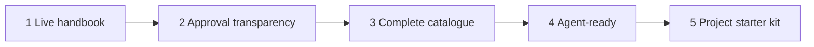

# Delivery Roadmap

## Scope and status

Deliver the public, read-first handbook described in [product.md](product.md), built with the stack and publishing rules in [project-guidelines.md](project-guidelines.md) and the design in [styleguide.md](styleguide.md).

All tasks are planned and unchecked. This roadmap does not claim that a site, repository integration, content migration, or deployment exists.

Out of scope for these phases: application authentication, a database or separate backend, contextual questions, rich-text proposals, and an application-managed approval workflow.

The source handbook is `C:/source/business/operations/governance/engineering-handbook`. Import only content reviewed for public release. Keep public availability, policy approval, and product adoption distinct.

## How phases are structured

Each phase is a vertical slice of the application: new site capability **plus** the content that makes it useful, released to production and verified on the public URL. No phase is only a content batch, and no capability ships without real content exercising it.

| Phase | Application capability delivered | Content published | Who can now do what |
| --- | --- | --- | --- |
| 1 | Styled site, search, status labels, CI/CD with checks and proven rollback | Home, Engineering introduction, Documentation standard | Anyone can read a real standard and see that it is a draft; maintainers can ship and revert safely |
| 2 | Approval record per standard, approval status page, citable rule IDs, revision footer | Approval status, four core standards | Readers know exactly what is approved and can cite a single rule |
| 3 | Task-based discovery, catalogue navigation, unpublished-reference handling, redirects | Nine remaining standards, task guide | Engineers find every standard relevant to their task |
| 4 | Markdown output per page, Copy page, page index for agents, versioned releases | Agent usage guide | Coding agents retrieve the exact published text and its revision |
| 5 | Patterns and templates sections, template download, content-type labels | Three patterns, five templates, adoption guidance | Teams start a project from the handbook; this repository is the only editable source |

## Definition of done for every phase

A phase is complete only when all of the following hold. A local build, merged PR, or successful upload alone does not complete a phase.

- [ ] Changes reached production through the reviewed default-branch pipeline; no manual uploads.
- [ ] Pull-request checks passed: production build, internal link and anchor check, and automated accessibility scan.
- [ ] New content passed publication review; withheld material is recorded without disclosing it.
- [ ] Phase acceptance checks pass on the public URL in a signed-out browser, on desktop and narrow screens, in light and dark themes.
- [ ] Acceptance checks from every earlier phase still pass; published routes and heading links still resolve or deliberately redirect.
- [ ] The release record lists the production URL, deployed commit, workflow run, verification results, and withheld content. It contains no secrets or confidential excerpts.
- [ ] [project-guidelines.md](project-guidelines.md) and [styleguide.md](styleguide.md) reflect any decision changed during the phase.

## Delivery rules

- Execute phases in order. Each phase extends the same production site; never build a second site or temporary implementation.
- Make each migrated page authoritative in this repository at its cutover. Do not edit another copy in the source folder; coordinate with its owner rather than deleting it.
- Preserve policy wording and rule IDs during formatting changes. Wording changes required for public release are reviewed and never inherit approval for different wording.
- Never link to a page that is not published. Use the style guide's “Not yet published” treatment, and resolve it when the target ships.
- Never invent approval records or label products compliant.

## Before Phase 1 — entry decisions

These decisions gate implementation. They are not a delivery phase.

- [ ] PRE.01 Accept Astro + Starlight as a documentation-specific exception to the source handbook's Next.js direction, or switch the plan to Next.js + Fumadocs.
- [ ] PRE.02 Choose the GitHub owner and repository; confirm GitHub Pages availability for that account and repository visibility.
- [ ] PRE.03 Name the publication reviewer who clears source content for public release.
- [ ] PRE.04 Accept the style guide's proposed colors, fonts, and text wordmark, or record replacements.

## Phase 1 — Live handbook with one real standard

**Deliverable:** Anyone can open the public handbook, find and search the Documentation standard, and see that it is a non-binding draft. Maintainers can ship a reviewed change and roll it back.

### Site foundation

- [ ] P1.01 Scaffold Astro + Starlight in this repository; remove all demo content; set the site title, description, and Engineering section.
- [ ] P1.02 Pin the Node.js and package-manager versions; commit the lockfile; define install, dev, build, and preview commands.
- [ ] P1.03 Configure Astro `site` and the GitHub Pages repository-path `base`; confirm links and assets resolve under that path.

### Style guide implementation

- [ ] P1.04 Implement the `--hb-*` color tokens for light and dark themes and map them onto Starlight properties via `customCss`.
- [ ] P1.05 Self-host the accepted fonts and set `--sl-font` and `--sl-font-mono` with system fallbacks.
- [ ] P1.06 Style the header (wordmark, section link, search trigger, theme toggle), sidebar, reading column, and “On this page” to the style guide's layout and breakpoints.
- [ ] P1.07 Extend the docs frontmatter schema with `status`, `version`, `owner`, and `decision`; fail the build when a standard omits `status`.
- [ ] P1.08 Override `PageTitle` to render breadcrumb, title, lead description, status badge, and metadata row; render the draft notice for draft standards.
- [ ] P1.09 Style rules tables, callouts, body links, inline code, and code blocks to the style guide.

### Content

- [ ] P1.10 Publication-review `README.md` and `standards/documentation.md`; identify internal, customer-specific, and out-of-folder references before import.
- [ ] P1.11 Publish the home page, the public-safe Engineering introduction, and the Documentation standard with its status frontmatter, rule IDs, and anchors intact.
- [ ] P1.12 Render references to unpublished guidance as “Not yet published” text, not links.

### Delivery pipeline

- [ ] P1.13 Add pull-request checks: lockfile install, production build, internal link and anchor check, and an automated accessibility scan of built pages.
- [ ] P1.14 Prove the link check by running it against a deliberately broken link in an unmerged branch.
- [ ] P1.15 Add the production workflow deploying the default branch to GitHub Pages with `contents: read`, `pages: write`, and `id-token: write`; select GitHub Actions as the Pages source and restrict deployment to the default branch.
- [ ] P1.16 Confirm the built output contains no planning documents, environment files, or source business files.
- [ ] P1.17 Deploy to production and record the release.
- [ ] P1.18 Rollback drill: ship a harmless reviewed change, revert it through a reviewed commit, and confirm production serves each expected version in turn. Confirm a failing build leaves production unchanged.

### Phase 1 acceptance

- [ ] A signed-out visitor loads the home page and the Documentation standard over HTTPS, including by direct URL.
- [ ] Searching a term from the Documentation standard finds and opens it.
- [ ] The page shows the Draft badge, “Deferred for detailed review”, and the draft notice, matching the source approval register.
- [ ] Layout, theme toggle, and keyboard focus match the style guide on desktop and a 390px-wide screen.
- [ ] A copied heading link opens the intended section.
- [ ] The rollback drill and failing-build check are recorded.

## Phase 2 — Approval transparency and citable rules

**Depends on:** Phase 1 done.

**Deliverable:** For every published standard, readers see its approval record (or that none exists) and can link to a single rule. The core engineering standards are available.

### Approval data

- [ ] P2.01 Publication-review `APPROVAL.md`. Model the approval register as one structured data collection: per standard, status, decision, date, decision authority, scope, and approved revision when one exists.
- [ ] P2.02 Validate the collection at build time: every published standard has an entry, statuses use the Draft/Approved/Superseded vocabulary, and an Approved entry requires a revision and approver.
- [ ] P2.03 Derive each page's status badge and decision from the collection, removing the `status` and `decision` frontmatter introduced in Phase 1; `version` and `owner` stay in frontmatter.

### Features

- [ ] P2.04 Render the approval record panel at the end of each standard, showing **No approval recorded** when no approval exists.
- [ ] P2.05 Publish the Approval status page from the same collection, with the review guidance and decision history from the public-safe register.
- [ ] P2.06 Add a build-time Markdown step that gives each rule-ID table row a stable anchor (`#doc-05`) and makes the ID a self-link.
- [ ] P2.07 Show “Last updated” from Git history and the deployed commit in the page footer.
- [ ] P2.08 Style Approved and Superseded badges and verify them using a test fixture outside the published content; do not publish fake approvals.

### Content

- [ ] P2.09 Publication-review and publish `standards/architecture.md`.
- [ ] P2.10 Publication-review and publish `standards/typescript.md`.
- [ ] P2.11 Publication-review and publish `standards/testing.md`.
- [ ] P2.12 Publication-review and publish `standards/nextjs.md`.
- [ ] P2.13 Replace “Not yet published” references whose targets now exist with links.
- [ ] P2.14 Deploy to production and record the release.

### Phase 2 acceptance

- [ ] All five published standards show an approval record matching the source register; none claims approval.
- [ ] The Approval status page and each page's panel show identical data for the same standard.
- [ ] Opening `…/documentation/#doc-05` scrolls to and highlights rule DOC-05; the same works for a rule in each newly published standard.
- [ ] Removing a standard's approval entry in an unmerged branch fails the build.
- [ ] Page footers show a last-updated date and the deployed commit.

## Phase 3 — Complete catalogue with task-based discovery

**Depends on:** Phase 2 done.

**Deliverable:** An engineer starting any kind of change can find every relevant published standard through the task guide, navigation, or search.

### Features

- [ ] P3.01 Publish a “Read by task” page from the source README table, linking only to published standards.
- [ ] P3.02 Group the Standards sidebar per the style guide and make the task guide reachable from the home page and Engineering introduction.
- [ ] P3.03 Extend the link check to fail when content links to an unpublished or missing route, so “Not yet published” stays honest.
- [ ] P3.04 Tune search: exclude navigation chrome from the index and confirm rule tables and approval records are searchable.
- [ ] P3.05 Add redirects for any route renamed since Phase 1; never break a published URL.

### Content

- [ ] P3.06 Publication-review and publish `standards/interfaces.md`.
- [ ] P3.07 Publication-review and publish `standards/storage.md`.
- [ ] P3.08 Publication-review and publish `standards/identity-security.md`; publishing security guidance does not add authentication to the site.
- [ ] P3.09 Publication-review and publish `standards/ai-execution.md`.
- [ ] P3.10 Publication-review and publish `standards/evaluation.md`.
- [ ] P3.11 Publication-review and publish `standards/observability.md`.
- [ ] P3.12 Publication-review and publish `standards/delivery.md`.
- [ ] P3.13 Publication-review and publish `standards/ux.md`.
- [ ] P3.14 Publication-review and publish `standards/visual.md`.
- [ ] P3.15 Add approval records for every new standard and resolve references between standards.
- [ ] P3.16 Reconcile the catalogue against all 14 source standards; record any withheld standard and its release decision.
- [ ] P3.17 Deploy to production and record the release.

### Phase 3 acceptance

- [ ] Every row of the task guide leads to published standards without a broken link.
- [ ] Every publication-cleared standard is reachable by sidebar, search, and direct URL, and shows its approval record.
- [ ] Representative searches (e.g. “rollback”, “WebSockets”, “WCAG”, “prompt”) return the expected standard.
- [ ] Every Phase 1 and 2 URL and rule anchor still resolves.

## Phase 4 — Agent-ready handbook

**Depends on:** Phase 3 done.

**Deliverable:** A coding agent, given one public URL, can list the published pages and retrieve the exact Markdown of any standard together with the handbook version and commit it came from.

### Features

- [ ] P4.01 Generate a Markdown file for every published page at build time from the same content source. Include title, status, decision, version, and deployed commit as a header block.
- [ ] P4.02 Generate one index of all published pages listing title, page URL, Markdown URL, content type, and status.
- [ ] P4.03 Add **View Markdown** and **Copy page** to the page header; Copy page copies the generated Markdown and confirms success or failure accessibly.
- [ ] P4.04 Introduce handbook release versions: tag each production release, show the version in the footer, and include it in the Markdown header and index.
- [ ] P4.05 Add build checks: every page has a Markdown file, the index lists every page, and Markdown rule IDs match the page's anchors.

### Content

- [ ] P4.06 Publish an agent usage page: where the index lives, how to cite rule IDs and versions, and that published availability does not mean approval.
- [ ] P4.07 Document how products pin a handbook version, using the repository-access decision from PRE.02.
- [ ] P4.08 Deploy to production and record the release.

### Phase 4 acceptance

- [ ] Fetching the index and a standard's Markdown with a plain HTTP client returns the expected content, version, and commit.
- [ ] The Markdown for the Documentation standard matches its rendered rules and approval status.
- [ ] Copy page places the same Markdown on the clipboard in a real browser.
- [ ] A coding agent given only the index URL retrieves the correct standard and cites a rule ID with the handbook version.

## Phase 5 — Project starter kit and source cutover

**Depends on:** Phase 4 done.

**Deliverable:** A team can start and review a project using the handbook's patterns and templates. This repository is the only editable source of the published handbook.

### Features

- [ ] P5.01 Add Patterns and Templates sections and a content-type label (Standard, Pattern, Template) in the page header; patterns and templates show no approval panel unless the register covers them.
- [ ] P5.02 Add **Download template** to template pages, reusing the Phase 4 Markdown output rather than separate copies.
- [ ] P5.03 Add the new content types to the agent index.

### Content

- [ ] P5.04 Publication-review and publish `patterns/use-case-and-adapters.md`.
- [ ] P5.05 Publication-review and publish `patterns/background-work-and-progress.md`.
- [ ] P5.06 Publication-review and publish `patterns/ai-improvement-and-approval.md`.
- [ ] P5.07 Publication-review and publish `templates/product.md`.
- [ ] P5.08 Publication-review and publish `templates/architecture.md`.
- [ ] P5.09 Publication-review and publish `templates/roadmap.md`.
- [ ] P5.10 Publication-review and publish `templates/project-profile.md`.
- [ ] P5.11 Publication-review and publish `templates/change-review.md`.
- [ ] P5.12 Publish the public-safe adoption guidance from the source README and resolve every remaining “Not yet published” reference, or record why it stays unpublished.

### Cutover

- [ ] P5.13 Reconcile the complete source inventory (README, approval register, 14 standards, 3 patterns, 5 templates) against published and withheld content.
- [ ] P5.14 Agree with the source owner that this repository owns future edits and that the source folder directs maintainers here.
- [ ] P5.15 Write the maintainer guide outside the published content tree: local preview, publication review, approval evidence, release, and rollback.
- [ ] P5.16 Deploy to production, tag the release, and record it.

### Phase 5 acceptance

- [ ] Each publication-cleared pattern and template is reachable by navigation, search, direct URL, and the agent index.
- [ ] A template downloads as usable Markdown without access to the source folder or repository.
- [ ] A maintainer who did not build the site completes a reviewed content change and its rollback using only the maintainer guide.
- [ ] The inventory reconciliation is recorded and no build or page depends on a workstation path.

## Deferred decisions

These do not block any phase above:

- **Custom domain:** choose the domain before planning DNS changes. The GitHub Pages URL suffices for all phases.
- **Contextual questions, rich-text proposals, application-managed approvals:** define behavior and architecture separately before adding phases. The static site does not implement them.
- **Authentication or private access:** not required for the public reading experience.
